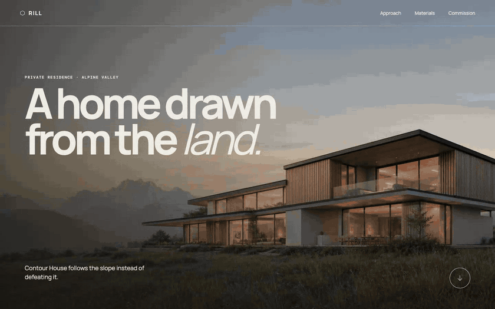

# Rill Architecture — a premium service page built with DESIGN:OS

**Live:** https://jangtrinh.github.io/design-os-rill-architecture/



*Full-quality recording: [docs/demo.mp4](docs/demo.mp4).*

A single-page experience for a fictional residential architecture studio: an image-led
spatial narrative — mountain-home hero, site analysis, a sticky "lived sequence", and
topic-specific material studies (timber, stone, plaster) — choreographed with GSAP
parallax under a strict motion-direction layer. It is the featured treatment from the
DESIGN:OS interaction-boundary benchmark, where the same toolchain also produced a
product-marketing page and a native-mobile UI.

## The studio is fictional

Rill Architecture is not a real firm; every project, place, and claim on the page was
written for this benchmark, and the imagery is AI-generated. Do not cite any of it.
What *is* real is how the page is built: the design-system discipline, the motion
direction, and the quality gates it had to pass.

## How it works

| Piece | What it is |
|---|---|
| Structure | One `index.html` — semantic sections for hero, site analysis, lived sequence, material studies, and contact. |
| Motion | `motion.js` — GSAP 3 + ScrollTrigger: parallax depths, a sticky lived-sequence, and scroll-revealed material studies, all under one shared motion direction (no per-section improvisation). |
| Styling | `styles.css` — type scale (Manrope + DM Mono) and a five-token palette (`--paper`, `--ink`, `--muted`, `--line`, `--rust`); every color in the page resolves through `var()`, none is repeated by hand. |
| Imagery | `assets/media/` — seven AI-generated WebP plates (hero, site analysis, house, three material studies, conclusion). |

## Reproduce it with DESIGN:OS

This page came out of [DESIGN:OS](https://github.com/jangtrinh/design-os), a
multi-runtime design CLI. You describe what you want in plain words inside the agent CLI
you already use (Claude Code, Codex CLI, or Antigravity); DESIGN:OS supplies the taste —
personas, a compiled design system, and deterministic quality gates the model cannot
talk past.

```sh
npm install -g ease-design     # the DESIGN:OS kernel — the `ui` binary
cd ~/your-project
ui init --runtime claude       # or: codex / antigravity
ui doctor --cwd .              # confirms the project is wired
```

Then describe the page to your agent in plain words:

```
/ui:generate a premium service page for a residential architecture studio —
image-led spatial narrative, parallax hero, a sticky lived-in sequence,
and per-material study sections
```

Start from the
[60-second quickstart](https://github.com/jangtrinh/design-os/blob/main/QUICKSTART.md);
the personas, motion direction, and lint gates that shipped this page run identically on
your machine.

## Run it locally

```sh
python3 -m http.server 4315 --bind 127.0.0.1
```

Then open http://127.0.0.1:4315. Static page — no build step; GSAP and fonts load from
public CDNs.

## Author

Built by [Jang Trịnh](https://www.jang.work/?utm_source=github&utm_medium=readme&utm_campaign=design-os-rill-architecture). More projects, case studies and writing at [jang.work](https://www.jang.work/?utm_source=github&utm_medium=readme&utm_campaign=design-os-rill-architecture).
